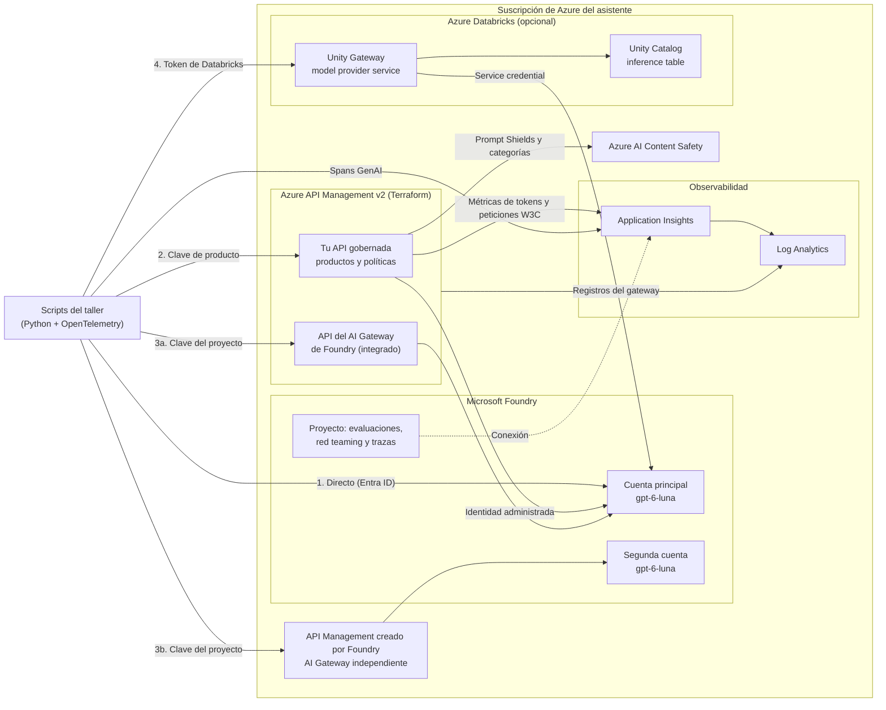

# De modelos a IA gobernada: AI Gateways con Azure API Management, Microsoft Foundry y Databricks

Taller práctico de nivel introductorio, de 3 horas (180 minutos), sobre el papel de los AI gateways en el gobierno de soluciones de IA generativa. Toda la infraestructura se despliega en Azure con Terraform y Azure Developer CLI (`azd`).

Construir una aplicación con IA es relativamente sencillo. El reto aparece al llevarla a la empresa: hay que controlar quién accede a los modelos, cuánto consume, cómo se comporta, si sus respuestas son adecuadas y aplicar políticas de forma consistente. En este taller avanzarás desde el consumo directo de un modelo hasta una arquitectura gobernada, observable y evaluable.

## Qué aprenderás

- Qué es un AI gateway y qué problemas resuelve frente al consumo directo de un modelo
- Cómo se comparan y complementan Azure API Management como AI gateway, el AI Gateway de Microsoft Foundry y Databricks Unity Gateway
- Cómo aplicar control de acceso, límites y cuotas de tokens, protección ante fallos y seguridad de contenido como código
- Cómo recopilar y analizar trazas y registros de las interacciones con modelos, con OpenTelemetry y Azure Monitor
- Cómo analizar el comportamiento de una solución con Red Teaming y evaluaciones antes de llevarla a producción
- Cómo diseñar una arquitectura en la que los modelos se consumen de forma segura, observable, evaluable y gobernada

## Agenda

| Inicio | Duración | Bloque | Material |
| :--- | ---: | :--- | :--- |
| 0:00 | 15 min | Bienvenida, objetivos y arranque del despliegue | [Preparación](docs/00-preparacion.md) |
| 0:15 | 20 min | De modelos a IA gobernada: conceptos y comparativa | [Conceptos](docs/01-conceptos.md) |
| 0:35 | 10 min | Laboratorio 1: consumo directo del modelo | [Lab 1](docs/labs/lab-01-consumo-directo.md) |
| 0:45 | 25 min | Laboratorio 2: AI gateway con Azure API Management | [Lab 2](docs/labs/lab-02-ai-gateway-apim.md) |
| 1:10 | 30 min | Laboratorio 3: AI Gateway de Foundry, independiente e integrado con API Management | [Lab 3](docs/labs/lab-03-ai-gateway-foundry.md) |
| 1:40 | 10 min | Descanso | |
| 1:50 | 20 min | Laboratorio 4: trazabilidad y observabilidad | [Lab 4](docs/labs/lab-04-observabilidad.md) |
| 2:10 | 25 min | Laboratorio 5: Red Teaming y evaluaciones | [Lab 5](docs/labs/lab-05-red-teaming-evaluaciones.md) |
| 2:35 | 15 min | Laboratorio 6: Databricks Unity Gateway (demo y laboratorio opcional) | [Lab 6](docs/labs/lab-06-unity-gateway.md) |
| 2:50 | 10 min | Conectando las piezas y cierre | [Arquitectura integrada](docs/02-arquitectura-integrada.md) |

Si eres instructor, consulta la [guía del instructor](docs/guia-instructor.md).

## Arquitectura

Todas las rutas llegan a un despliegue de `gpt-6-luna` en Microsoft Foundry con el mismo SDK de OpenAI. Lo que cambia es quién autentica, quién aplica las políticas y dónde quedan las trazas.



Terraform crea la instancia de API Management, tu API y las dos cuentas de Foundry. Las dos APIs del AI Gateway de Foundry las crea Foundry cuando lo habilitas desde su portal en el laboratorio 3: una dentro de tu instancia (modo integrado) y otra en una instancia nueva que crea el propio Foundry (modo independiente).

## Arranque rápido

Sigue la [guía de preparación](docs/00-preparacion.md) para instalar los requisitos y autenticarte. El resumen es este:

```powershell
azd config set auth.useAzCliAuth true
az login --tenant <tenant-id>
az account set --subscription <subscription-id>
azd env new <id-entorno>
azd env set AZURE_SUBSCRIPTION_ID <subscription-id>
azd env set AZURE_LOCATION swedencentral
azd env set APIM_PUBLISHER_EMAIL <tu-email>
azd provision backend
azd provision resources
uv sync
uv run python -m workshop.lab01_direct
```

Los comandos crean un entorno `azd` aislado, despliegan el estado remoto de Terraform y los recursos del taller, e instalan las dependencias de Python. El último comando ejecuta el primer laboratorio.

## Estructura del repositorio

| Ruta | Contenido |
| :--- | :--- |
| [`azure.yaml`](azure.yaml) | Proyecto `azd` con tres capas Terraform: `backend`, `resources` y `databricks` (opcional) |
| [`inf/backend/`](inf/backend/) | Capa 1: almacenamiento del estado remoto de Terraform, sin claves compartidas |
| [`inf/resources/`](inf/resources/) | Capa 2: dos cuentas de Microsoft Foundry, Content Safety, API Management, Log Analytics y Application Insights |
| [`inf/databricks/`](inf/databricks/) | Capa 3 opcional: Azure Databricks Premium y Unity Gateway delante del mismo modelo |
| [`src/workshop/`](src/workshop/) | Scripts de los laboratorios, consultas KQL y datos de evaluación |
| [`docs/`](docs/) | Preparación, conceptos, guías de laboratorio, arquitectura integrada y guía del instructor |

## Coste y limpieza

Los recursos tienen coste mientras existen, sobre todo las instancias de API Management Basic v2 y el consumo de tokens. Al terminar, quita primero los proyectos de los dos AI Gateways en el portal de Foundry y elimina ambos gateways, como explica el [laboratorio 3](docs/labs/lab-03-ai-gateway-foundry.md). Después elimina todo el entorno:

```powershell
azd down databricks
azd down resources
azd down backend
```

Las capas se eliminan en orden inverso a su creación. Con Terraform, `azd down` ejecuta `terraform destroy`; la configuración del provider purga los recursos con borrado temporal, como las cuentas de Foundry y la instancia de API Management, para que puedas volver a crear el entorno con los mismos nombres. `azd down resources` borra también la instancia de API Management que creó Foundry si está en el grupo de recursos del entorno.
