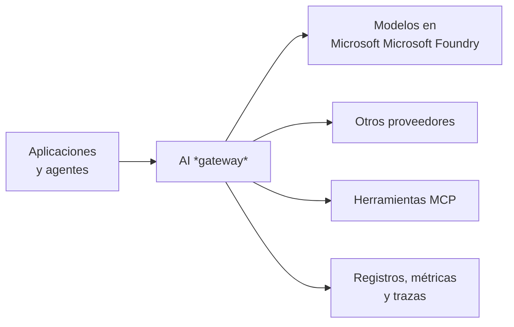

# De modelos a IA gobernada: conceptos

Duración: 20 minutos. Este módulo introduce el vocabulario del taller y compara las tres tecnologías que vas a usar.

## Del prototipo a la empresa

Llamar a un modelo es una línea de código. Llevar esa llamada a producción plantea preguntas que el código de la aplicación no responde bien por sí solo:

| Pregunta | Riesgo si no se responde |
| :--- | :--- |
| ¿Quién puede usar qué modelo? | Claves compartidas en el código, accesos que nadie revoca |
| ¿Cuánto consume cada equipo o aplicación? | Una aplicación agota la cuota de todas; costes sin dueño |
| ¿Qué pasa si el modelo se satura o falla? | Errores en cascada y reintentos que empeoran la saturación |
| ¿Qué entra y qué sale del modelo? | *Prompts* maliciosos, fugas de datos, contenido dañino |
| ¿Qué ha pasado en una conversación concreta? | Incidentes imposibles de reconstruir y auditar |
| ¿Responde bien y de forma segura? | Regresiones de calidad y riesgos descubiertos por los usuarios |

Resolver cada pregunta en cada aplicación produce soluciones distintas e inconsistentes. Un AI *gateway* las resuelve una sola vez, en un punto común.

## Qué es un AI *gateway*

Un AI *gateway* es un intermediario entre los consumidores (aplicaciones, agentes, *notebooks*) y los modelos o herramientas de IA. Aplica políticas de gobierno de forma uniforme sin que cada aplicación tenga que implementarlas.

Sus capacidades se agrupan en cinco familias:

- **Identidad y acceso**: quién llama y a qué tiene derecho. El *gateway* termina la credencial del consumidor y usa su propia identidad hacia el modelo, así nadie más necesita claves del modelo.
- **Consumo y tráfico**: límites de tokens por minuto, cuotas por periodo, reintentos, circuit breaker, balanceo entre despliegues y caché semántica.
- **Seguridad de contenido**: inspección de *prompts* y respuestas, detección de *jailbreaks* (`Prompt Shields`) y listas de bloqueo.
- **Observabilidad**: uso de tokens por consumidor, registro de *prompts* y respuestas, métricas y trazas distribuidas.
- **Gobierno como código**: todas las políticas se definen, revisan y despliegan igual que el resto de la infraestructura.

El *gateway* no sustituye a las evaluaciones ni al «Red Teaming»: el *gateway* controla el tráfico en tiempo de ejecución, mientras que evaluar y atacar de forma controlada mide si la solución se comporta bien **antes** de llegar a producción y mientras está en ella.

## Las tres aproximaciones del taller

### Azure API Management como AI *gateway*

El recurso o servicio deAzure API Management es el *gateway* de APIs de Azure con capacidades específicas para modelos de lenguaje. En este taller lo usas en un `tier v2`, que se aprovisiona en minutos.

- Políticas de IA:
  - `llm-token-limit` → límite por minuto y cuota por periodo, por cualquier clave
  - `llm-content-safety` → Azure AI Content Safety y Prompt Shields
  - `llm-emit-token-metric` → emite métricas de tokens hacia Application Insights
  - `llm-semantic-cache` → caché semántica
- Backends con identidad administrada, *circuit breaker* y *pools* de balanceo
- Productos y suscripciones para separar consumidores; OAuth y Microsoft Entra ID para escenarios avanzados
- Métricas de tokens por suscripción, producto o API en Application Insights con `llm-emit-token-metric`
- Funciona con modelos de Microsoft Foundry y con otros proveedores compatibles con OpenAI, Anthropic o Vertex AI

Microsoft ha presentado también un tier específico, *AI Gateway tier* (*preview*), con un asistente para importar modelos y herramientas MCP.

### Microsoft Microsoft Foundry: gobierno integrado en la plataforma

Microsoft Microsoft Foundry ofrece gobierno desde el propio portal:

- **AI Gateway de Microsoft Foundry** (*preview*): se habilita a nivel de recurso de Microsoft Foundry y usa una instancia de API Management v2 por debajo. Tiene dos modos (los cuales practicarás durante el laboratorio 3):
  - **independiente**, en el que Microsoft Foundry crea su propia instancia
  - **integrado**, en el que se asocia a una instancia existente, como la puerta corporativa. Permite fijar límites de tokens y cuotas por proyecto y registrar agentes y herramientas MCP para gobernarlos.
- **Filtros de contenido** asociados a cada despliegue de modelo.
- **Trazas** con convenciones semánticas GenAI de OpenTelemetry, almacenadas en el Application Insights conectado al proyecto.
- **Evaluaciones** de calidad y seguridad
- **Red Teaming Agent**, basado en `PyRIT`, para descubrir riesgos de forma automatizada.

Es la opción natural cuando los equipos construyen en Microsoft Foundry y quieren gobierno sin gestionar API Management directamente. Si necesitas políticas a medida, la instancia de API Management sigue disponible.

### Databricks Unity Gateway

Unity Gateway es la solución de gobierno de IA de Azure Databricks, construida sobre Unity Catalog. Trata modelos, proveedores externos y servidores MCP como objetos de Unity Catalog:

- **Model provider services**: registran un proveedor externo, como Azure OpenAI o Microsoft Microsoft Foundry, con sus credenciales cifradas o con una *service credential* basada en identidad administrada
- **Privilegios de Unity Catalog** (`EXECUTE`, `USE CATALOG`, `USE SCHEMA`) para controlar quién consulta cada servicio, igual que con las tablas
- **Rate limits** por usuario, grupo, service principal o servicio; presupuestos; reparto de tráfico y *fallbacks*
- **Service policies** como guardrails: integradas, propias o de terceros
- **Observabilidad**: tabla de sistema `system.ai_gateway.usage`, *inference tables* con las cargas, y la **tabla unificada de trazas** (*beta*), que registra en formato OpenTelemetry toda la actividad que atraviesa sus servicios en una única tabla de Unity Catalog

Es la opción natural para cargas que viven en la plataforma de datos: *notebooks*, *jobs*, `ai_query` y agentes de Databricks, gobernados junto con los datos que usan.

## Comparativa

| Dimensión | Azure API Management (APIM) | AI Gateway en Microsoft Foundry | Databricks Unity Gateway |
| :--- | :--- | :--- | :--- |
| Ámbito principal | Cualquier API o modelo, en Azure o fuera | Modelos, agentes y herramientas de un recurso de Microsoft Foundry | Modelos, proveedores externos y MCP en Databricks |
| Control de acceso | Suscripciones, productos, OAuth y Entra ID | RBAC de Azure y proyectos | Privilegios de Unity Catalog |
| Credencial hacia el modelo | Identidad administrada del *gateway* | Gestionada por Microsoft Foundry | Credenciales de servicio (*service credential*) o secreto en Unity Catalog |
| Límites de consumo | Tokens por minuto y cuotas por cualquier clave | Tokens por minuto y cuotas por proyecto | Peticiones o tokens por usuario, grupo o servicio, y presupuestos |
| Seguridad de contenido | `llm-content-safety` con Content Safety | Filtros de contenido del despliegue | Políticas de servicio (*service policies*) |
| Resiliencia | Reintentos, `circuit breaker`, *pools* | Heredada de API Management | Reparto de tráfico y *fallbacks* |
| Observabilidad | Azure Monitor, Application Insights | Trazas, evaluaciones y monitorización, Application Insights y para agentes *custom* cualquier *endpoint* de OpenTelemetry | Tablas de sistema, inference tables y tabla unificada OpenTelemetry |
| Gobierno como código | Terraform, Bicep, APIOps | Terraform o Bicep para los recursos, *scripting* para ciertos escenarios avanzados | Terraform, Declarative Automation Bundles y SDK |

## Cómo se complementan

No son alternativas excluyentes. En una misma empresa conviven patrones como estos:

1. **Azure API Management como puerta corporativa** para todas las aplicaciones, con cuotas por equipo y un único punto de auditoría. También como interface con el mundo exterior al ecosistema de la empresa.
2. **Microsoft Foundry** para quienes construyen agentes y aplicaciones en la plataforma, con su AI Gateway apoyado en la misma tecnología de Azure API Management, y con evaluaciones y «Red Teaming» como parte del ciclo de vida.
3. **Unity Gateway** para el consumo desde la plataforma de datos, con permisos alineados con Unity Catalog, incluso hacia el mismo despliegue de Microsoft Foundry, como harás en el laboratorio 6.

Lo importante es decidir qué *gateway* gobierna cada tipo de consumo, que todos apliquen límites coherentes y que las trazas puedan correlacionarse de extremo a extremo.

## Referencias

- [AI gateway en Azure API Management](https://learn.microsoft.com/azure/api-management/genai-*gateway*-capabilities)
- [Configurar el AI Gateway en recursos de Microsoft Foundry](https://learn.microsoft.com/azure/foundry/configuration/enable-ai-api-management-*gateway*-portal)
- [AI Red Teaming Agent](https://learn.microsoft.com/azure/foundry/concepts/ai-red-teaming-agent)
- [Evaluaciones en la nube con el SDK de Microsoft Foundry](https://learn.microsoft.com/azure/foundry/observability/how-to/cloud-evaluation)
- [Gobierno de IA con Unity Gateway](https://learn.microsoft.com/azure/databricks/ai-*gateway*/)
- [Tabla unificada de trazas de Unity Gateway](https://learn.microsoft.com/azure/databricks/ai-*gateway*/unified-trace-table)
