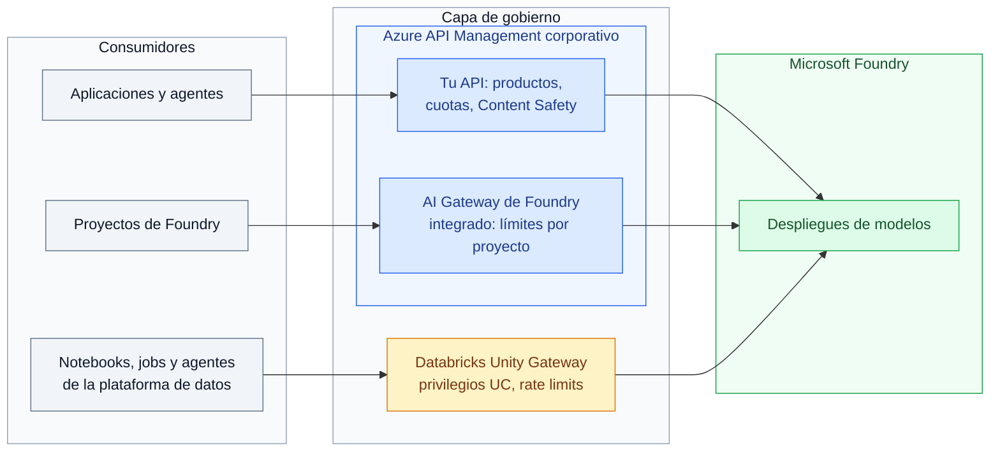
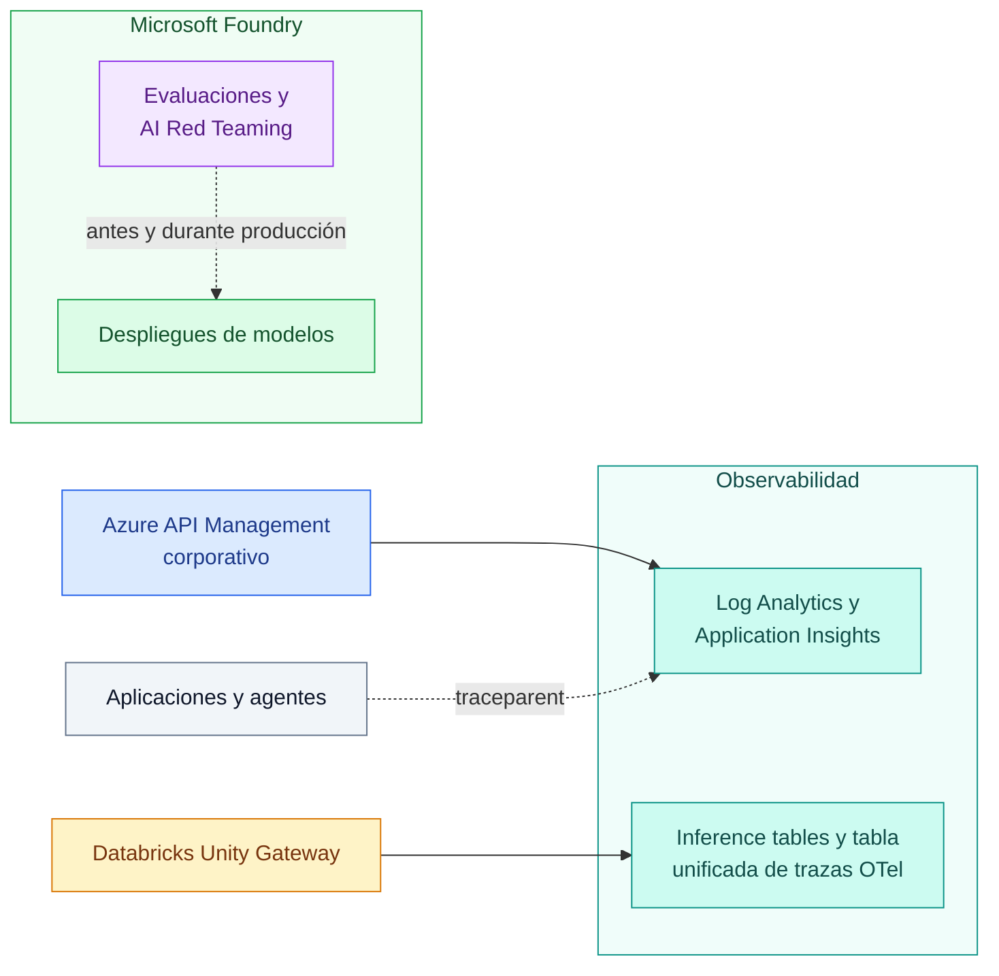

# Conectando las piezas: arquitectura integrada

Duración: 10 minutos. Este cierre une lo que has construido y lo proyecta hacia producción.

## Lo que has construido

### Consumo gobernado



Los tres recorridos llegan a los mismos despliegues. Azul: API Management; ámbar: Unity Gateway; verde: modelos en Foundry.

### Observabilidad y evaluación



Turquesa: telemetría; violeta: evaluación. Esta vista separa los flujos de observabilidad y evaluación de las llamadas a los modelos.

Cuatro propiedades resumen el taller:

| Propiedad | Cómo se consigue |
| :--- | :--- |
| Segura | Sin claves de modelo: identidades administradas y service credentials; Content Safety y Prompt Shields en el gateway |
| Gobernada | Productos, suscripciones y privilegios de Unity Catalog; límites y cuotas de tokens como código |
| Observable | Métricas de tokens con `llm-emit-token-metric`, registros del gateway y trazas OpenTelemetry correlacionadas de extremo a extremo |
| Evaluable | Red Teaming y evaluaciones automatizados en el proyecto de Foundry |

## Cómo decidir qué gateway gobierna cada consumo

- Si el consumidor es una aplicación de negocio o un agente fuera de la plataforma de datos, pasa por API Management, la puerta corporativa con cuotas por equipo.
- Si el consumidor vive en Databricks, gobiérnalo con Unity Gateway para que sus permisos se alineen con los datos que usa.
- Si los equipos construyen en Foundry y necesitan límites por proyecto sin gestionar políticas, usa el AI Gateway de Foundry. Asócialo a la instancia corporativa de API Management (modo integrado) para compartir red, observabilidad y operación; reserva el modo independiente para equipos que empiezan sin equipo de plataforma.
- En el modo integrado, cada objeto tiene un único dueño: lo que declara Terraform se cambia en Terraform y lo que crea Foundry se cambia desde Foundry.
- Mantén límites coherentes entre gateways sobre el mismo despliegue: la suma de cuotas no debe superar la capacidad del modelo.

## Del taller a producción

| Área | En el taller | En producción |
| :--- | :--- | :--- |
| Red | Endpoints públicos | Private endpoints, Foundry sin acceso público, API Management Standard v2 o Premium v2 con integración de red |
| Identidad del consumidor | Claves de suscripción | Microsoft Entra ID con `validate-azure-ad-token`, más suscripciones para la atribución |
| Capacidad | Un despliegue en una región | Backend pools entre regiones y despliegues, incluida capacidad provisionada |
| Coste | Cuotas fijas por producto | Cuotas por equipo con presupuestos, alertas y caché semántica |
| Datos registrados | Métricas de tokens y registros sin cuerpos | Retención y acceso restringido; registro de contenido solo con enmascaramiento según la clasificación de los datos |
| Calidad y seguridad | Ejecuciones manuales | Evaluaciones y Red Teaming en CI/CD, evaluación continua y umbrales de salida |
| Cambios | `azd provision` local | Pipelines con revisión de pull requests y entornos separados |

## Despliegue de la arquitectura

Autentícate con Azure CLI y crea o selecciona tu entorno de `azd` siguiendo [la guía de preparación](00-preparacion.md). Despliega las capas base en orden y revisa cada vista previa antes de aplicar los cambios:

```powershell
azd provision backend --preview
azd provision backend
azd provision resources --preview
azd provision resources
```

La capa `backend` prepara el estado remoto de Terraform. La capa `resources` despliega Foundry, API Management y los recursos de observabilidad.

Para incluir Unity Gateway y el recorrido desde Databricks, despliega también la capa opcional después de `resources`:

```powershell
azd provision databricks --preview
azd provision databricks
```

Despliega solo en tu entorno DEV aislado. Nombra siempre la capa: `azd provision` sin argumento incluye también Databricks.

## Limpieza

Elimina tu entorno al terminar para no generar costes. Primero, en **Manage**, **AI Gateway** del portal de Foundry, quita los proyectos de los dos gateways y elimina ambos. Después:

```powershell
azd down databricks
azd down resources
azd down backend
```

Si no desplegaste la capa `databricks`, omite el primer comando.
